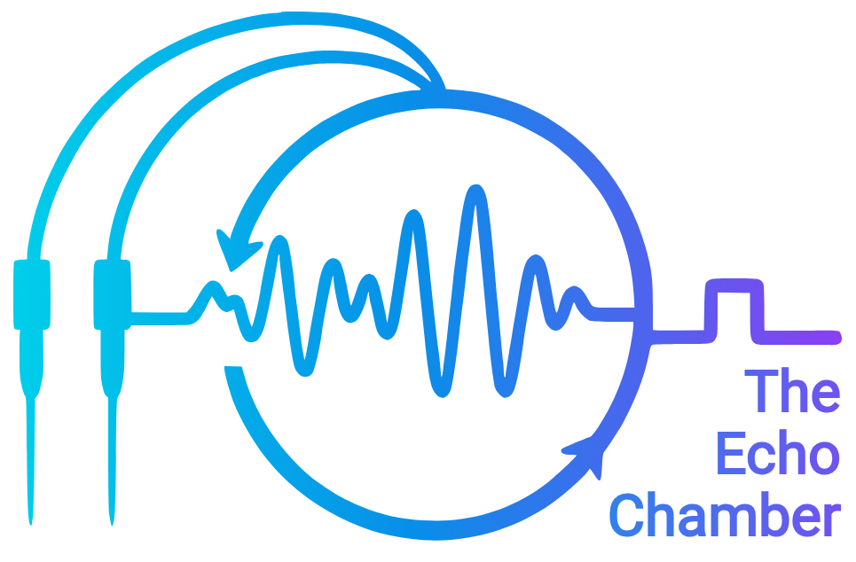

# The Echo Chamber

<p align="center">
  
</p>

The Echo Chamber is research software for low-latency, closed-loop LFP
acquisition with an NI USB-6343. The application records CA3 and cortical
signals and supports interchangeable rule, PID, and Echo State Network (ESN)
controllers through a shared pulse-output path. The ESN also retains its
passthrough mode.

> **Required software runs completed; timing qualification failed.** The full
> suite passes with 286 tests and 17 subtests on Python 3.12.14 and Python
> 3.14.0. It ran on an uncommitted candidate based on `996dd1e`, later
> committed as isolated `4967720` and cherry-picked as main `ef81a23`. The
> runtime-input proof verifies its captured non-documentation inputs against
> the c16 main snapshot, with line-ending-only differences in 30 files. Suite
> logs and the source-hash manifest are in
> [progress-reporting validation](docs/validation/progress-reporting/README.md).
> The
> `e965d808` replay matrix completed all nine 30-minute cases and failed the
> strict timing gates: all nine maxima were 9.959 to 199.559 ms, and the three
> ESN p99 values were 2.700 to 3.022 ms. That matrix predates the reviewed
> moment-only ESN rebase. All three current-bridge full-recording ESN parity
> cases passed exact event/trigger-index checks and the unchanged threshold
> tolerance. The `6657c88` paced ESN diagnostic, run before the progress-
> reporting fix, faulted and stopped recording at 21,606,700 samples. The replay
> later processed all 36 million source samples. Its 38.7395 ms maximum and
> 237 deadline misses failed timing. A 64-second synthetic PID tracking
> diagnostic on that revision passed its simulation gates, but all three
> actual-Core segments failed the strict maximum-time gate. Neither diagnostic
> establishes runtime performance for the later progress-reporting fix. See
> [implementation and validation status](IMPLEMENTATION_STATUS.md) for the
> final required-run evidence and qualification result.
>
> A 32-second diagnostic on `bb65477` processed and recorded 640,000 samples
> per controller. Rule p99/max were 2.190158/4.2422 ms with zero deadline
> misses. PID measured 2.439674/5.7394 ms with one miss. ESN measured
> 2.776818/5.401 ms with one miss. These short runs are not acceptance. The
> `bb65477` full nine-case replay matrix then completed and failed: all nine
> maxima exceeded 5 ms, and all three ESN p99 values exceeded 2.5 ms. Every
> case recorded 36 million samples with no source gaps, zero AO active-demand
> misses, late commands, or stale rejections, and a completed AO drain. An
> independent closed-file audit found no structural issues. See the
> [full matrix report](docs/validation/replay-bb65477/README.md). The
> matrix used a WebSocket client without browser rendering. The 45-second
> post-calibration lead sweep has audited coverage for all 18 controller/lead
> cases using unpaced processing with a virtual AO scheduler; runtime timing
> gates failed in 15 and passed in 3. Full-duration
> timing was not evaluated. See
> [the lead-sweep evidence](docs/validation/lead-sweep-650c4a4/README.md).
> The nine-case unpaced matrix ran on `bb65477`; the three 30-minute paced
> runs with an actual browser ran on `c16c0ee`. The combined bundle was
> assembled at c16, with per-run source revisions preserved. The matrix is
> included because subsequent changes were outside its measured timed-component
> scope. All nine matrix cases and all three paced runs have completed. The
> combined status is **REQUIRED FULL RUNS
> FAILED**: all nine matrix cases and all three paced cases fail at least one
> strict timing gate. Rule and PID paced runs recorded all 36 million samples;
> the ESN paced run stopped acquisition and recording at 5,564,500 samples
> after a simulated AO active-demand fault. See the
> [final required-run bundle](docs/validation/required-runs-c16c0ee/README.md)
> for metrics and the independent closed-file audit.
> The earlier default simulation export wrote JSON then failed during CSV
> serialization; a separate PID control segment also faulted and recorded
> only a prefix. The post-fix retry wrote all three CSV rows but had a separate
> ESN-stimulated AO fault; all functional simulation gates still failed. See
> the [earlier audit](docs/validation/default-simulation-2a3a1fb/README.md)
> and [post-fix retry](docs/validation/default-simulation-ef81a23/README.md).
> The 64-second post-fix PID tracking diagnostic passed modeled tracking and
> recovery checks, but the control segment faulted before full recording; all
> three segment maxima exceeded 5 ms. See
> [the tracking audit](docs/validation/tracking-ef81a23/README.md).
> A separate injected 150 ms stall proof passed the expected cancellation,
> zero-output, no-effect, and drain checks, while correctly failing runtime
> acceptance for the faulted prefix. It is software-only evidence: see
> [the stall audit](docs/validation/stall-150ms-ef81a23/README.md).
> The final runtime-input proof verified all 69 captured code, test, config,
> model, and UI files against the 286-test manifest. Main matched the tested
> inputs with no content differences; 30 files differed only by line endings.
> This proves input provenance only, not timing or hardware behavior. The
> proof is included in the final required-run bundle.
>
> **Hardware status: ALL UNVERIFIED.** The included hardware profile contains
> working assumptions, not measured calibration. Do not treat software results
> or the profile as evidence of physical output, safety, or biological effect.

`echoChamber.py` is the supported development application.
`echoChamber_v4.py` is retained only as the previous NI-tested reference.

The post-run CSV fix only serializes unavailable tracking metrics as null and
accepts older summaries without that optional field. It does not change the
processing path measured by the prior full matrix or lead sweep. The PID
control fault from the first attempt did not recur in the retry; the retry
instead faulted in ESN stimulation. No cause is established.

## What changed

- The live runtime uses a checksummed numeric `.npz` artifact and never loads
  pickle files.
- The ReservoirPy graph was replaced by an inference-only NumPy/Numba loop. Its
  recurrence was verified exactly against ReservoirPy 0.3.11 for the supplied
  model.
- The current ESN bridge has SHA-256
  `88469989b45429ec270f55e37139c96a1565ae91193dd2113c7b332d4e9c4749`. Its
  moment-only rebase recalculates centered moments without rebuilding the live
  peak queue or changing its absolute sample sequence. Full-recording parity
  passed on all three canonical recordings; the prior `f6147a59` parity bundle
  remains historical evidence for the earlier bridge revision. The model
  recurrence and artifact were unchanged.
- Input and target scaling are separate in the corrected training path.
- The 20 kHz input is anti-aliased, decimated to 2 kHz, causally low-pass
  filtered, evaluated by the ESN, and causally returned to 20 kHz.
- Stimulation starts off, at gain zero, and unarmed. Arming is explicit and is
  cleared by control mode, acquisition stop, stimulation off/zero, or a fault.
- AO outcomes record immutable pulse origins and absolute sample ranges. The
  runtime retains unresolved writes until the scheduler confirms commitment or
  cancellation. Settings revisions, calibration epochs, and drain acknowledgments
  gate rearming; changes never arm output automatically.
- The HDF5 v5 recorder prepares metadata rows in source order and appends each
  populated dataset once per batch. The reader uses the top-level format tag to
  validate v5 channel metadata. This also fixes an undefined `format_tag`
  lookup that raised `NameError` on the legacy fallback and malformed-v5
  validation paths. Exact old/new fixture comparison matched all
  ten signal and metadata datasets. The comparison is saved in
  [the fixture proof](docs/validation/recorder-batching/h5-batching-fixture-parity.json).
  A balanced 10-versus-50 diagnostic improved p99 but worsened backlog and
  runtime; the default batch size remains 50. The diagnostic does not establish
  a performance benefit from metadata batching.
- Finite-source EOF and application shutdown flush queued AO outcomes after the
  AO producer stops and before HDF5 closes. Recorder close retries do not queue
  duplicate sentinels. Failed writes leave an incomplete file at the last fully
  committed boundary. The runtime does not create a synthetic source block for
  the AO flush.
- Benchmark progress reporting uses a bounded, single-owner writer and a
  rolling 2,048-call interim p99 window; final timing gates still use the full
  latency history. Writer and simulated-AO shutdown timeouts are explicit case
  failures. An unresolved owner stops collection and prevents further writes
  to its shared progress log.
- The recorder process prototype remains parked. In one 60-second A/B/A ESN
  diagnostic, the process arm's p99 of 3.533 ms was higher than both threaded
  runs at 3.423 and 3.495 ms. Its 8.898 ms maximum was between threaded maxima
  of 6.855 and 9.286 ms. All three missed strict
  timing limits. The comparison did not isolate a cause or show a repeatable
  benefit. See [the prototype diagnostic](docs/validation/process-recorder-prototype/README.md).
- Pulse detection supports absolute, positive, and negative polarity. Absolute
  is the default. The current pulse is an explicit 5 ms, 100 Hz sine half-cycle.
- Real-hardware startup uses the included confirmed-pending-test profile by
  default and warns until its values are replaced with measured ones.
- Recording uses compact, compressed `echoChamber_H5_v5` files with true NI
  sample indices, calibration metadata, AO target indices, arm state, faults,
  and sparse events.
- A full reader check compared an earlier complete 36-million-sample v5 Rule
  file with canonical mV input. It found zero sample, index, block, controller,
  or mode mismatches. See [the reader report](docs/validation/full-reader-98b6ed/README.md).
- The browser monitor is self-contained and does not require internet access.

See [IMPLEMENTATION_STATUS.md](IMPLEMENTATION_STATUS.md) for the completed
software execution record and timing qualification failures. Hardware
validation remains unverified.

## Install

Python 3.12 and 3.14 are supported and tested.

```powershell
python -m venv .venv
.\.venv\Scripts\python -m pip install -r requirements.txt
```

For development tests:

```powershell
.\.venv\Scripts\python -m pip install -r requirements-dev.txt
.\.venv\Scripts\python -m pytest -q
```

## Mock replay

Run the bundled whole-slice 4-AP recording without NI hardware:

```powershell
python echoChamber.py --mock
```

The application starts in control mode, stimulation off, gain zero, and
unarmed. The sidecar beside the sample makes its AI0=CA3, AI1=Cortex mapping and
the conflict with its embedded metadata explicit.

Use another Echo Chamber recording:

```powershell
python echoChamber.py --mock-replay recordings\recording.h5
```

Passthrough can exceed the pulse-oriented sustained-output safety rules. It may
be bypassed only for a disconnected scope or dummy-load test:

```powershell
python echoChamber.py --mock --dry-test-allow-sustained-ao
```

The same explicit flag is allowed for NI bench testing but emits a prominent
warning. Use it only with a scope or dummy load because it bypasses charge,
duty-cycle, and continuous-output trips.

## Real-hardware testing

The default command now uses the corrected artifact and the included
`hardware_profiles/lab_pending_test.json` working profile:

```powershell
python echoChamber.py
```

The profile records these confirmed-pending-test assumptions: AI0=CA3,
AI1=Cortex, amplifier gain 10, one AO volt per ESN physical output unit, absolute
pulse polarity, and the current ISO-Flex-oriented safety values. The application
warns but does not refuse the run. Command-line calibration/safety overrides are
also permitted and logged.

Select another profile or artifact explicitly when needed:

```powershell
python echoChamber.py `
  --hardware-profile hardware_profiles\lab_rig_reviewed.json `
  --model-artifact artifacts\esn_corrected_v1.npz
```

The explicit arm step, software limits, and warnings do not replace electrical
isolation, current/charge protection, an emergency stop, or bench observation.

## Select and validate a controller

The application supports the ESN, rule, and PID controllers. The ESN remains
the default. Select a controller from the browser UI or with `--controller`.
The rule and PID controllers use the causal CA3 envelope from 100 to 250 Hz.
The envelope smooths squared values over 10 ms. Rule and PID each need one
second of settling and ten valid unstimulated seconds before they are ready.
The rule controller triggers above 3 standard deviations and rearms below
1.5. The PID controller requests a bounded rate from 0 to 2 Hz.

Rule and PID output stays disarmed until baseline calibration and the AO drain
complete. You must arm explicitly. The hardware PID settings are zero-gain in
[`controller_configs/pid_hardware.json`](controller_configs/pid_hardware.json).
The nonzero values in
[`controller_configs/pid_synthetic_demo.json`](controller_configs/pid_synthetic_demo.json)
are for software demonstrations only. They are not hardware tuning values.
The separate `--tracking-simulation` validation uses the software-only PID
preset `kp=0.2`, `ki=0.06`, `kd=0`, and `target_z=1`. It does not change the
hardware PID settings.

On a fault, the scheduler cancels AO commands that have not reached the writer.
Samples already accepted into the NI output buffer may still play at their
scheduled indices while the output drains. `ao_committed` records software
buffer acceptance. It does not confirm voltage or current at an isolator or
electrode.

The canonical replay files go in `recordings/ca3_slow_waves/`. Their channel
positions retain the labels CA3 and EC. The controller roles are CA3 and
Cortex. The importer treats ABF samples as stored mV values and applies no
second amplifier-gain conversion.

Run a short software smoke test or the full nine-case matrix after importing
the replay files:

```powershell
python tools\validate_controllers.py --smoke
python tools\validate_controllers.py --matrix --keep-recordings
```

To keep the real UI and recorder active for a 30-minute software run, start a
local static server, then run the paced command. Open each `browser_required`
URL from the progress JSONL. The default path is
`work/validation_runs/progress.jsonl`. If you pass `--output-dir`, the CLI
writes the progress file there as `progress.jsonl`.

```powershell
python -m http.server 8000 --directory .
python tools\validate_controllers.py --paced --external-browser `
  --browser-base-url http://127.0.0.1:8000 --paced-seconds 1800 --keep-recordings
```

Run `--tracking-simulation` to compare the PID controller against the
deterministic responsive plant with stimulation disabled. The report includes
rate-limited plant capacity, fixed-band target error, and recovery checks. A
capacity calculation alone does not establish PID tracking; use
`simulation_acceptance_passed` in the result and treat a failed or unverified
tracking gate as such. The plant is a software fixture, not a tissue model.
These replay and simulation commands do not establish SWR ground truth,
biological efficacy, or physical stimulation.
The staged NI procedure remains unverified and requires a lab operator.
Read the [controller validation guide](docs/controller_validation.md),
[replay import guide](docs/replay_import.md), and
[NI staged test protocol](docs/ni_controller_protocol.md) before those runs.

## Corrected ESN training

The supplied notebook reused one scaler for CTX and CA3 and serialized only its
last, CA3-fitted coefficients. The corrected default model was therefore refit
from the paired source recordings; the historical pickle could not recover the
missing CTX scaling.

The held-out result passed: mean Pearson correlation was `0.260` versus
`-0.260` for the historical readout, and mean nRMSE was `1.007` versus `2.062`.
Fourteen training pairs were matched by ascending electrode rank within each
experiment group; that pairing rule is documented as confirmed pending test.

To reproduce the artifact from the source folders:

```powershell
python -m esn.train `
  --training-ctx "PATH\connected\CTX" `
  --training-ca3 "PATH\connected\CA3" `
  --validation-ctx "PATH\validation\X_data" `
  --validation-ca3 "PATH\validation\Y_data" `
  --seed-artifact artifacts\esn_legacy_compat_v1.npz `
  --output artifacts\esn_corrected_v1.npz
```

Training preserves the supplied reservoir weights, input weights, bias, leak
rate, and topology. It fits separate training-only input and target scalers,
refits the ridge readout after a one-second washout, resets state per recording,
and compares held-out correlation and normalized RMSE with the legacy readout.

## Legacy migration

Only the isolated migration tool accepts trusted project-author pickle files.
Never use it on an untrusted pickle.

```powershell
python -m pip install -r requirements-legacy-migration.txt
python tools\migrate_legacy_model.py `
  --model PATH\model.pkl `
  --secondary PATH\secondary_objs.pkl `
  --output artifacts\esn_legacy_compat_v1.npz
```

The result is retained for numerical compatibility and comparison. If selected
for an NI run, the application warns that its validation is pending but does not
block the run.

## Benchmark and recordings

Run the 5 ms processing benchmark against synthetic or recorded data:

```powershell
python benchmarkEchoChamberProcessing.py --stim-mode off
python benchmarkEchoChamberProcessing.py `
  --input sample\test_AI0_CA3_AI1_CTX.h5 --stim-mode off
```

Plot a recording:

```powershell
python readEchoChamberData.py recordings\recording.h5
python readEchoChamberData.py recordings\recording.h5 `
  --start 10 --duration 30 --save echo-plot.png --no-show
```

HDF5 v5 stores compressed `float32` AI/AO signals, calibration, block-level ESN
diagnostics, AO pipeline delay, arm state, and discontinuity/mode/pulse events.
The reader also supports prior Echo Chamber HDF5 versions.

## Contributors

- [Adam Armada-Moreira](https://github.com/adam-says)
- [Angel Canal-Alonso](https://github.com/AngelCanal)
- [Alessio Di Clemente](https://github.com/alediclemente)
- [Laura Monni](https://github.com/LauraMonni1)
- [Michele Giugliano](https://github.com/mgiugliano)
