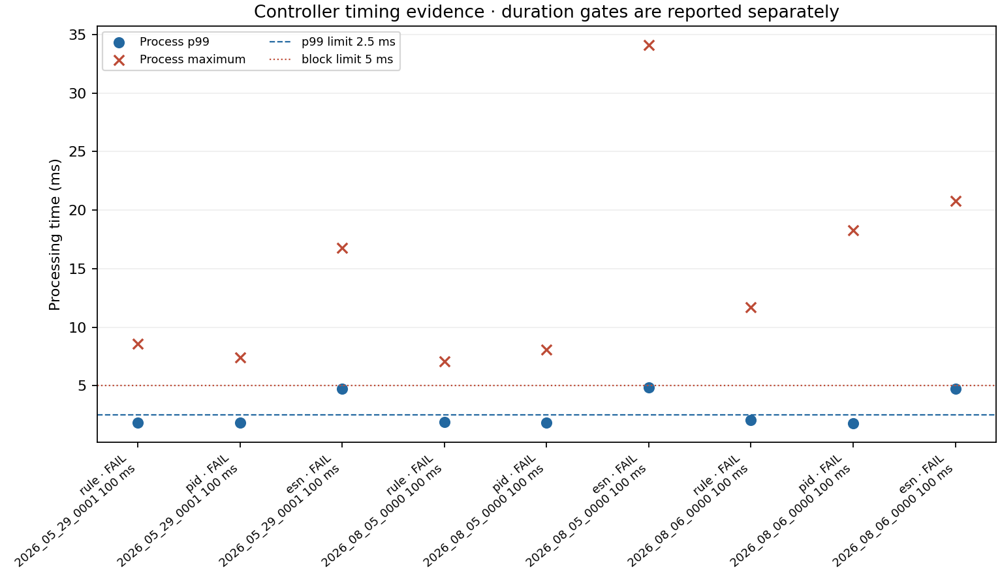

# Controller validation evidence

**Overall status:** REQUIRED FULL RUNS FAILED

**Short diagnostic status:** NOT REPORTED

Physical hardware and monitor behavior remain **unverified**. Software AO scheduling and synthetic-plant commands are reported separately and do not establish physical delivery or biological effect.

Coverage reference: 1800 seconds, 360,000 blocks, 36,000,000 samples per full recording.

Per-block process timing covers the controller, renderer, safety adapter, recorder submission, and UI submission. Asynchronous health checks remain separate. Unpaced recorder backpressure waits occur between blocks and are excluded from that timing. Browser connection and packet consumption do not prove that a person saw rendered frames.

## Required full-duration runs

- Nine-case unpaced matrix: **FAIL** (9/9 cases).
- Three-controller paced runs: **NOT REPORTED** (0/3 controllers).

| Status | Run | Source | Controller | Blocks | Samples | p99 ms | Max ms | Gaps | Skipped | AO misses, late, stale, zero | Recorder | Browser lifecycle |
|---|---|---|---|---:|---:|---:|---:|---:|---:|---|---|---|
| FAIL | matrix @ 100.0 ms | 2026_05_29_0001 | rule | 360,000 / 360,000 | 36000000 / 36,000,000 | 1.871 | 8.563 | 0 | 0 | 0, 0, 0, 20 | complete=True; committed=36,000,000/source=36,000,000/processed=36,000,000 | not required |
| FAIL | matrix @ 100.0 ms | 2026_05_29_0001 | pid | 360,000 / 360,000 | 36000000 / 36,000,000 | 1.843 | 7.443 | 0 | 0 | 0, 0, 0, 20 | complete=True; committed=36,000,000/source=36,000,000/processed=36,000,000 | not required |
| FAIL | matrix @ 100.0 ms | 2026_05_29_0001 | esn | 360,000 / 360,000 | 36000000 / 36,000,000 | 4.745 | 16.763 | 0 | 0 | 0, 0, 0, 20 | complete=True; committed=36,000,000/source=36,000,000/processed=36,000,000 | not required |
| FAIL | matrix @ 100.0 ms | 2026_08_05_0000 | rule | 360,000 / 360,000 | 36000000 / 36,000,000 | 1.899 | 7.095 | 0 | 0 | 0, 0, 0, 20 | complete=True; committed=36,000,000/source=36,000,000/processed=36,000,000 | not required |
| FAIL | matrix @ 100.0 ms | 2026_08_05_0000 | pid | 360,000 / 360,000 | 36000000 / 36,000,000 | 1.834 | 8.095 | 0 | 0 | 0, 0, 0, 20 | complete=True; committed=36,000,000/source=36,000,000/processed=36,000,000 | not required |
| FAIL | matrix @ 100.0 ms | 2026_08_05_0000 | esn | 360,000 / 360,000 | 36000000 / 36,000,000 | 4.830 | 34.104 | 0 | 0 | 0, 0, 0, 20 | complete=True; committed=36,000,000/source=36,000,000/processed=36,000,000 | not required |
| FAIL | matrix @ 100.0 ms | 2026_08_06_0000 | rule | 360,000 / 360,000 | 36000000 / 36,000,000 | 2.043 | 11.702 | 0 | 0 | 0, 0, 0, 20 | complete=True; committed=36,000,000/source=36,000,000/processed=36,000,000 | not required |
| FAIL | matrix @ 100.0 ms | 2026_08_06_0000 | pid | 360,000 / 360,000 | 36000000 / 36,000,000 | 1.810 | 18.306 | 0 | 0 | 0, 0, 0, 20 | complete=True; committed=36,000,000/source=36,000,000/processed=36,000,000 | not required |
| FAIL | matrix @ 100.0 ms | 2026_08_06_0000 | esn | 360,000 / 360,000 | 36000000 / 36,000,000 | 4.751 | 20.784 | 0 | 0 | 0, 0, 0, 20 | complete=True; committed=36,000,000/source=36,000,000/processed=36,000,000 | not required |

## Short timing diagnostics

No smoke or lead-sweep diagnostics were supplied.

## Failures and limits

- **20261028_230420_20261028T220420Z_2026_05_29_0001_rule_100ms (FAIL):** maximum process time reached or exceeded the block deadline; one or more blocks exceeded the processing deadline; maximum process time 8.563 ms is not below 5.0 ms; deadline-exceeded blocks: 13
- **20261028_231017_20261028T221017Z_2026_05_29_0001_pid_100ms (FAIL):** maximum process time reached or exceeded the block deadline; one or more blocks exceeded the processing deadline; maximum process time 7.443 ms is not below 5.0 ms; deadline-exceeded blocks: 33
- **20261028_231556_20261028T221556Z_2026_05_29_0001_esn_100ms (FAIL):** process p99 is not below 2.5 ms; maximum process time reached or exceeded the block deadline; one or more blocks exceeded the processing deadline; process p99 4.745 ms is not below 2.5 ms; maximum process time 16.763 ms is not below 5.0 ms; deadline-exceeded blocks: 2705
- **20261028_232701_20261028T222701Z_2026_08_05_0000_rule_100ms (FAIL):** maximum process time reached or exceeded the block deadline; one or more blocks exceeded the processing deadline; maximum process time 7.095 ms is not below 5.0 ms; deadline-exceeded blocks: 12
- **20261028_233259_20261028T223259Z_2026_08_05_0000_pid_100ms (FAIL):** maximum process time reached or exceeded the block deadline; one or more blocks exceeded the processing deadline; maximum process time 8.095 ms is not below 5.0 ms; deadline-exceeded blocks: 26
- **20261028_233842_20261028T223842Z_2026_08_05_0000_esn_100ms (FAIL):** process p99 is not below 2.5 ms; maximum process time reached or exceeded the block deadline; one or more blocks exceeded the processing deadline; process p99 4.830 ms is not below 2.5 ms; maximum process time 34.104 ms is not below 5.0 ms; deadline-exceeded blocks: 2966
- **20261028_235000_20261028T225000Z_2026_08_06_0000_rule_100ms (FAIL):** maximum process time reached or exceeded the block deadline; one or more blocks exceeded the processing deadline; maximum process time 11.702 ms is not below 5.0 ms; deadline-exceeded blocks: 59
- **20261028_235637_20261028T225637Z_2026_08_06_0000_pid_100ms (FAIL):** maximum process time reached or exceeded the block deadline; one or more blocks exceeded the processing deadline; maximum process time 18.306 ms is not below 5.0 ms; deadline-exceeded blocks: 19
- **20261029_000231_20261028T230231Z_2026_08_06_0000_esn_100ms (FAIL):** process p99 is not below 2.5 ms; maximum process time reached or exceeded the block deadline; one or more blocks exceeded the processing deadline; process p99 4.751 ms is not below 2.5 ms; maximum process time 20.784 ms is not below 5.0 ms; deadline-exceeded blocks: 2703

## Synthetic simulations

No simulation reports were supplied.

## Import verification

ABF import verification status: **verified** across 3 source files.
See the JSON summary for source and canonical replay hashes.

## Timing plot

