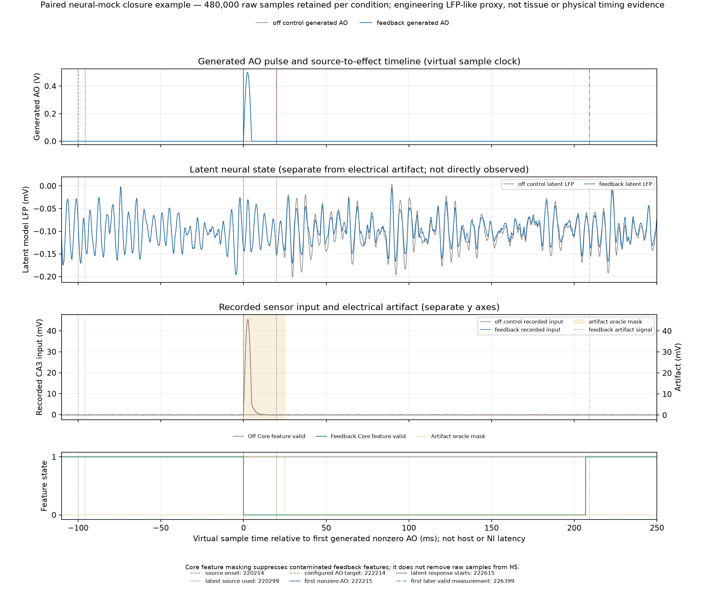

# Synthetic neural circuit closure demo

This paired, 24-second virtual-clock demo checks whether a Rule decision can pass through the shared actuator and AO scheduler, produce generated AO samples, change a small E/I neural-mass fixture after its configured delay, and change a later valid Rule measurement. It also checks that the Core’s programmed artifact mask covers the fixture’s known artifact interval and that finite-source shutdown drains cleanly.

This is an engineering fixture. The neural-mass parameters are not calibrated to tissue or a biological recording. Generated AO values are simulated commands, not proof of physical stimulation. The reported 100 ms source-to-AO lead and 20 ms model response are sample-clock settings; they are not measured host, NI, or physical latency.

## Final run

R4 passed all ten declared closure gates. Both paired conditions processed and recorded all 480,000 input samples at 20 kHz. The off condition generated no nonzero AO. In the Rule condition, the scheduler committed 2,200 pulse samples across 22 pulse requests and generated 2,178 nonzero AO command samples. There were no latched faults, unexplained drain outputs, or pending commands after shutdown. H5 electrode samples matched the observed synthetic CA3 input exactly in bounded chunks; the Cortex channel was zero, and all 4,800 diagnostic block offsets were contiguous.

The first event’s sample timeline was:

| Event | Sample index | Meaning |
|---|---:|---|
| Rule decision source onset | 220,214 | Controller request in the acquired source timeline |
| Rule input latest used | 220,299 | End of the 100-sample processing block |
| Target AO onset | 222,214 | Source onset plus the configured 2,000-sample lead |
| First generated nonzero AO | 222,215 | The shared pulse waveform begins with a zero-valued sample at its target onset |
| First neural-mass effect | 222,615 | 400 samples after first generated nonzero AO, the configured 20 ms model delay |
| First later valid Rule measurement change | 226,399 | End of a valid feature block after artifact masking and filter recovery |

The Rule baseline became calibrated at sample 220,000 and explicit arming occurred at 220,100. The first source decision at 220,214 therefore precedes the 12-second disturbance boundary at sample 240,000. The first 12 seconds must not be described as an entirely unstimulated baseline period; early feedback begins just after calibration becomes available.

The paired output supports a narrow circuit-closure and response-delay demonstration. It does not establish biological efficacy, regulation toward a biological target, or real-time/hardware performance.



The event-aligned sample rows are available in [timing-events.csv](timing-events.csv). The figure and CSV are generated by [tools/plot_neural_mock.py](../../../tools/plot_neural_mock.py), which reads the report-referenced NPZ traces without pickle support and checks their sample indices, events, AO, and masks.

## Reproduce

Use the isolated tested checkout revision recorded in [source-run-manifest.json](source-run-manifest.json) (base revision `c2e41199191d42b55298baaf46e9c868576d1b2b`; uncommitted candidate at execution). The manifest records Python 3.14.0, exact before/after hashes for 74 captured runtime inputs, and the command used. The recorded run left those inputs unchanged.

From the repository root, with the project’s Python environment and dependencies available, run:

```powershell
python tools/run_neural_mock.py `
  --output-dir C:\path\to\fresh\neural-mock-run `
  --duration-s 24 --seed 7 --upper-z 1.0 --lower-z 0.5
```

The output directory must not already exist. The tool writes paired H5 recordings, compressed model-trace sidecars, and `report.json`. It exits nonzero if any closure gate fails, while preserving the report. The checked-in [report.json](report.json) is the R4 summary; the recordings and NPZ traces remain in the task’s `outputs/neural-mock-24s-r4` directory and are intentionally not copied into this evidence folder.

The final repository unit suites passed under Python 3.12 and 3.14: 305 tests and 20 subtests in each. Exact logs, the source-capture manifest, and byte hashes are in [unit-tests](unit-tests/README.md). This was the same uncommitted candidate base recorded above; the manifest identifies its captured source files.

## Closure gates

The report requires complete paired input and H5 block coverage; no generated AO in the off condition; a Rule proposal, scheduler commitment, and generated nonzero AO in the feedback condition; neural response no earlier than the declared delay; paired latent divergence only after the model effect; a later measurement difference on a valid feature block; full coverage of artifact-oracle samples by Core-invalid feature samples; and fault-free draining with no unexplained nonzero output or pending commands.

Feature masks on Core blocks intentionally skipped during a generation transition are recorded as uncomputed and invalid. An empty mask on an otherwise eligible Rule-processing block remains an error. H5 input comparison is exact and chunked; diagnostic offsets and sample counts must be contiguous for the full finite input.

## Attempt history

[failure-history.json](failure-history.json) keeps the first two failed bring-up attempts. R1 failed because the runner treated a transition-skipped feature mask as a malformed full-size mask. R2 reached the end of both 480,000-sample recordings, but the already-disarmed off condition had three queued zero commands because EOF did not initiate a drain transaction. R3 passed after the EOF fix. R4 repeats the passing run with explicit block-start/latest-used measurement timestamps and a negative test proving a pulse canceled before commitment cannot affect the model or sensor artifact.

These earlier failures are retained as debugging history; they are not hidden by the final passing run.
